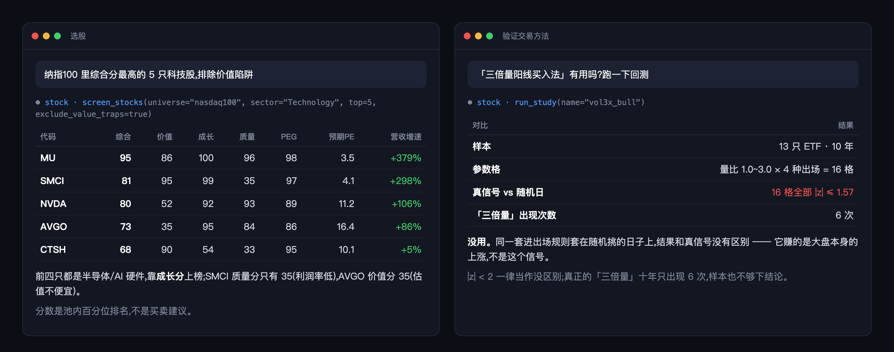
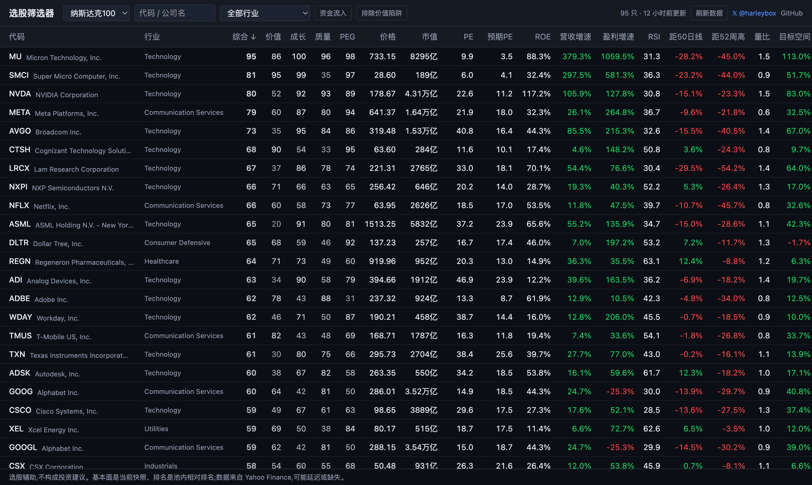
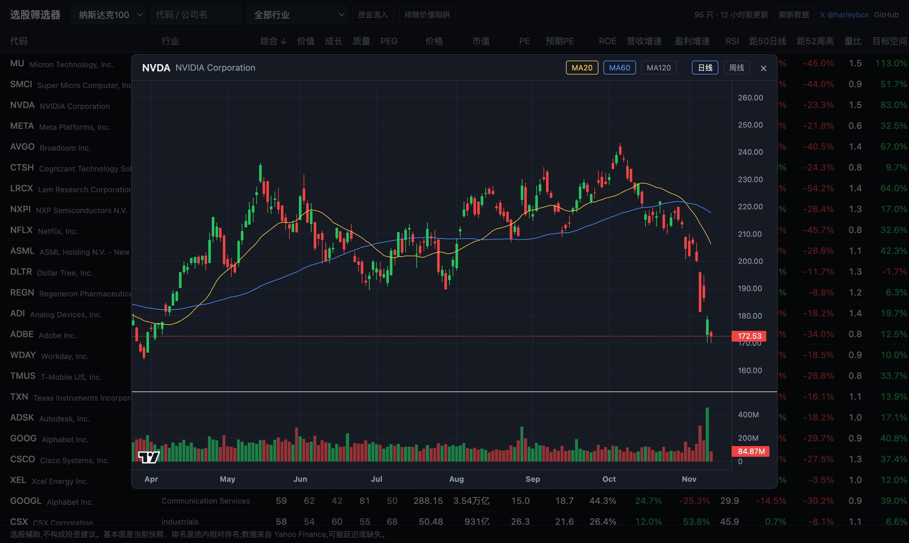

<div align="center">

# stock-mcp

### Give your AI a stock screener

Let Claude or Cursor rank every stock in an index and read price charts,<br>
then run a live backtest to check whether that trading recipe from the internet does anything.

[](LICENSE)


[](https://x.com/harleybox)

English · [中文](README.md)



<sub>Illustration (in Chinese). The numbers are real tool output from 2026-11-09.<br>
Left: "top 5 Nasdaq-100 tech stocks by combined score, excluding value traps". Right: "does the 3x-volume candle method work?"</sub>

</div>

## Why

- **No sign-up, no API key, no database server.** Data comes from Yahoo Finance and is cached in one local SQLite file.
- **The AI gets computed numbers instead of making them up.** Percentile ranks on four pillars, a money-inflow flag and a value-trap flag are calculated in code, then handed to the AI to interpret.
- **A built-in myth checker.** Every backtest has a placebo control: the same rules applied to randomly chosen days. A signal that cannot beat random days carries no information.

## Install in three steps

Requires Python 3.10+.

```bash
git clone https://github.com/harleybox/stock-mcp.git && cd stock-mcp
```

```bash
python3 -m venv .venv && .venv/bin/pip install -r backend/requirements.txt
```

```bash
claude mcp add stock -- "$PWD/.venv/bin/python" "$PWD/backend/mcp_server.py"
```

<details>
<summary>Claude Desktop, Cursor and other clients</summary>

Add this to the MCP config, using your absolute paths:

```json
{
  "mcpServers": {
    "stock": {
      "command": "/absolute/path/stock-mcp/.venv/bin/python",
      "args": ["/absolute/path/stock-mcp/backend/mcp_server.py"]
    }
  }
}
```

</details>

## Then just ask

> Top 10 tech stocks in the Nasdaq-100 by combined score, excluding value traps

> Where does NVDA rank, and how does it score on value versus growth?

> How has BTC done over the last 60 days? Is it above its 60-day average?

> Does buying after a 3x-volume bullish candle work? Run the backtest.

The first screen of a universe downloads data (about 1–2 minutes for the Nasdaq-100). The AI gets progress and retries; later calls hit the local cache.

## Three popular trading methods, tested

| Method | The claim | What the data says |
|---|---|---|
| Larry Williams outside day | 94% win rate on BTC | 1,190 signals; all 5 parameter cells indistinguishable from random days |
| 3x-volume bullish candle + pullback | Buy the low-volume pullback after a high-volume candle | All 16 parameter cells indistinguishable from random days; a true 3x-volume candle appeared 6 times in 10 years |
| EMA five-line bullish stack | Hold while all five EMAs are stacked | 9.0% a year, against 14.9% for buy and hold |

None of the three showed more than "buy on any random day". Method, full numbers and commands are in [research/](research/README.md) (Chinese), or ask the AI to run one with `run_study`.

**More backtest write-ups and market notes on X → [@harleybox](https://x.com/harleybox)**

## There is a web UI too

Also requires Node 20+. The UI is in Chinese.

```bash
./run.sh
```

Open <http://localhost:5173>. The web UI and the MCP server share the same local cache.



Click any row for its chart (daily / weekly, MA20 / 60 / 120, volume). `/?chart=NVDA` opens a ticker's chart directly.



## Tools

| Tool | What it does |
|---|---|
| `list_universes` | Available universes and which are already cached |
| `screen_stocks` | Rank a universe; sort by any column, filter by sector, money inflow, value traps |
| `get_stock` | Every metric for one ticker plus its rank in the universe |
| `get_price_history` | Daily / weekly bars for any Yahoo symbol (stocks, ETFs, crypto, A-shares) with period return and MA20/60/120 |
| `list_studies` | The built-in backtest studies |
| `run_study` | Run one study live and return its placebo-controlled report |

Universes: Nasdaq-100, S&P 500, CSI 300, SSE 50.

<details>
<summary><b>How the scores work</b></summary>

Each pillar is a **percentile rank within the universe** (0–100), not a hard-coded threshold:

| Pillar | Inputs | Weight |
|---|---|---|
| Value | P/E, forward P/E, P/B, EV/EBITDA | 30% |
| Growth | Revenue growth, earnings growth | 25% |
| Quality | ROE, net margin, gross margin | 25% |
| PEG | P/E ÷ earnings growth | 20% |

Also included:

- Technical snapshot: RSI, distance from the 50-day average and the 52-week high, relative volume
- Money-inflow flag: MFI > 50 and rising OBV
- Value-trap flag: high debt, or falling earnings with flat revenue

The core logic is in [backend/screener/fundamentals.py](backend/screener/fundamentals.py), one readable file.

</details>

<details>
<summary><b>Layout</b></summary>

```
backend/    mcp_server.py (MCP), app.py (web API), screener/ (scoring)
frontend/   React + lightweight-charts
research/   standalone backtest scripts
```

</details>

## Caveats

- A selection aid, not investment advice.
- Fundamentals are a current snapshot, not point-in-time history, so these scores **cannot be backtested** without look-ahead bias.
- Constituent lists are hand-maintained snapshots and may lag the real index.
- Yahoo data can be delayed, missing or rate-limited; retry after a few minutes if a fetch fails.

## License

[MIT](LICENSE) · If this is useful, a ⭐ helps, or come say hi on X: [@harleybox](https://x.com/harleybox)
