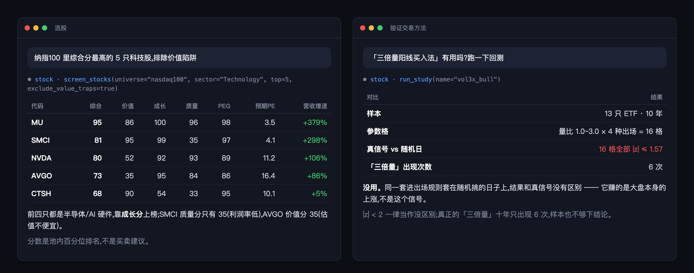
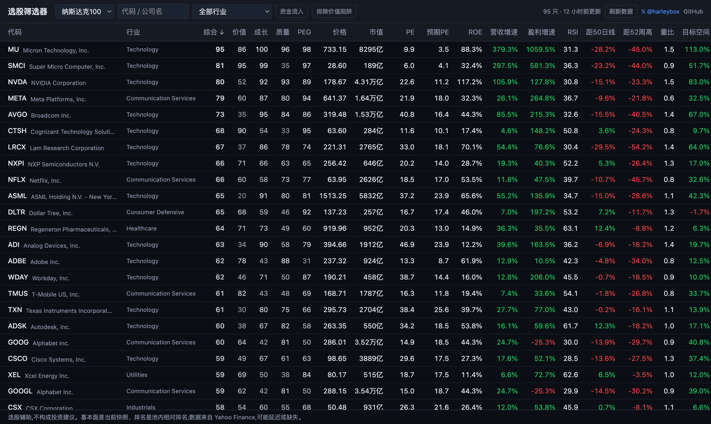
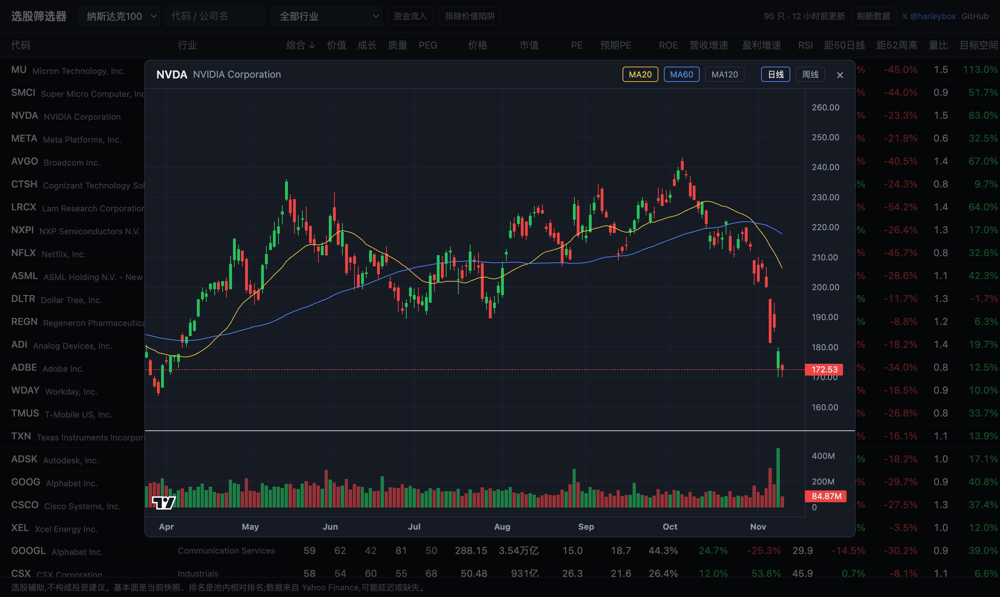

# stock-mcp

[English](README.en.md) · 中文 · [](https://x.com/harleybox) [](LICENSE)

**让 Claude、Cursor 帮你选股、看 K 线、跑回测的 MCP server。**

装上之后,你用一句话就能让 AI 把纳指100 的一百只票按估值、成长、质量排好名,查任意一只股票或币的走势,还能当场跑回测,看看网上流传的买入方法到底管不管用。

不用注册,不用 API key,数据免费,全部跑在你自己电脑上。



<sub>示意图,表里的数字是 2026-11-09 真实跑出来的。</sub>

## 它能做什么

### 1. 一句话筛完整个指数

> 纳指100 里又便宜、又在增长的科技股,给我前 10 个,高负债的不要

AI 会拿到指数里每只票的四项打分(价值、成长、质量、PEG)和综合分,再按你的要求排序、过滤。支持纳斯达克100、标普500、沪深300、上证50。

可以按任意指标排序,按行业筛,只看资金在流入的,或者把「看着便宜其实有坑」的价值陷阱剔掉。

### 2. 问清楚一只股票

> NVDA 现在算贵吗?在纳指100 里排第几?

返回这只票的全部数据:PE、预期 PE、ROE、营收和盈利增速、RSI、离 50 日线和 52 周高点多远、分析师目标价空间,以及它在指数里的综合名次和四项打分。

### 3. 查任意代码的走势

> BTC 这两个月走得怎么样,现在在 60 日线上面还是下面?

美股、ETF、A股、币,Yahoo 上有的代码都能查。日线、周线都行,附带区间涨跌幅、最高最低、MA20 / 60 / 120。

### 4. 当场验证一个交易方法

> 三倍量阳线买入法靠谱吗?跑一下回测给我看

AI 会真的跑一遍十年数据,然后告诉你结果。每份回测都带对照组:同样的买卖规则,套在随机挑的日子上再跑 30 遍。按信号买如果不比随机买强,这个方法就没用。

目前内置三份,结果是这样的:

| 方法 | 流传的说法 | 跑出来的结果 |
|---|---|---|
| Larry Williams 外包线 | BTC 胜率 94% | 1190 次信号,5 组参数,没有一组比随机挑日子强 |
| 三倍量阳线,回踩买入 | 放量大阳线后缩量回踩就是买点 | 16 组参数全部和随机一样 |
| EMA 五线多头排列 | 五条均线排好就拿着 | 年化 9.0%,一直拿着不动是 14.9% |

完整数字和脚本在 [research/](research/README.md)。更多验过的方法发在 X:**[@harleybox](https://x.com/harleybox)**

### 5. 不用 AI 也能用:自带网页版

同一份数据,一个可排序、可筛选的选股表,点任意一行出 K 线。





## 安装

需要 Python 3.10 以上。

```bash
git clone https://github.com/harleybox/stock-mcp.git && cd stock-mcp
```

```bash
python3 -m venv .venv && .venv/bin/pip install -r backend/requirements.txt
```

接到 Claude Code:

```bash
claude mcp add stock -- "$PWD/.venv/bin/python" "$PWD/backend/mcp_server.py"
```

<details>
<summary>接到 Claude Desktop、Cursor 或别的客户端</summary>

在 MCP 配置里加这一段,路径换成你电脑上的绝对路径:

```json
{
  "mcpServers": {
    "stock": {
      "command": "/绝对路径/stock-mcp/.venv/bin/python",
      "args": ["/绝对路径/stock-mcp/backend/mcp_server.py"]
    }
  }
}
```

</details>

装好就可以直接问了。第一次查某个指数要现拉数据,纳指100 大概等一两分钟,之后秒回。

想用网页版,再装一个 Node 20 以上,然后运行下面这条,打开 <http://localhost:5173>:

```bash
./run.sh
```

## 细节

<details>
<summary><b>分数怎么算的</b></summary>

四项都是在指数内部排名,0 到 100,没有写死的门槛:

| 项目 | 看什么 | 权重 |
|---|---|---|
| 价值 | PE、预期PE、PB、EV/EBITDA | 30% |
| 成长 | 营收增速、盈利增速 | 25% |
| 质量 | ROE、净利率、毛利率 | 25% |
| PEG | PE ÷ 盈利增速 | 20% |

另外还有:

- 资金流入:MFI 大于 50,同时 OBV 向上
- 价值陷阱:负债高,或者盈利在掉而营收没涨

全部逻辑在 [backend/screener/fundamentals.py](backend/screener/fundamentals.py),一个文件。

</details>

<details>
<summary><b>六个 MCP 工具</b></summary>

| 工具 | 作用 |
|---|---|
| `list_universes` | 有哪些指数,哪些已经有本地数据 |
| `screen_stocks` | 给一个指数打分排名,支持排序和过滤 |
| `get_stock` | 一只股票的全部指标和它在指数里的名次 |
| `get_price_history` | 日线或周线,附带区间涨跌和均线 |
| `list_studies` | 内置了哪些回测 |
| `run_study` | 现场跑一份回测 |

</details>

<details>
<summary><b>使用前要知道的</b></summary>

- 它不荐股、不预测涨跌、不能下单。分数表示一只票在指数里的相对位置,仅供研究,不构成投资建议。
- 数据来自 Yahoo Finance,可能延迟、缺失或被限流。拉不下来就过几分钟再试。
- 基本面是当天的数据,所以这套打分本身不能拿去回测。
- 成分股名单是手工维护的,可能比真实指数慢一点。

</details>

---

MIT 协议。觉得有用就点个 ⭐,更多回测和看盘笔记在 X:[@harleybox](https://x.com/harleybox)
